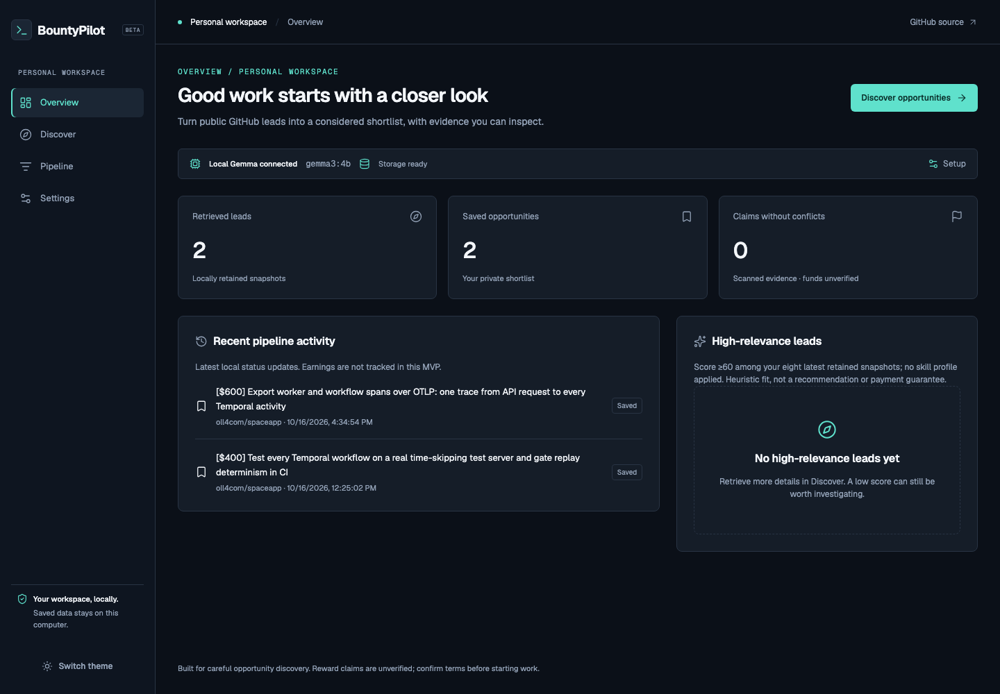
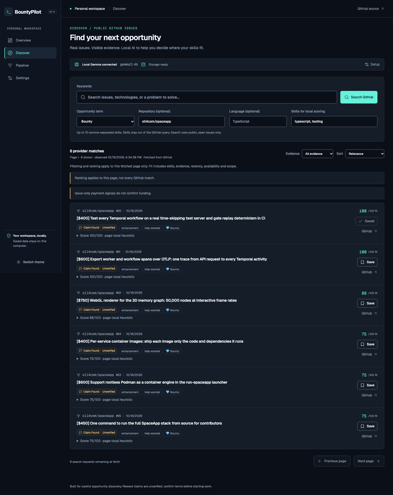
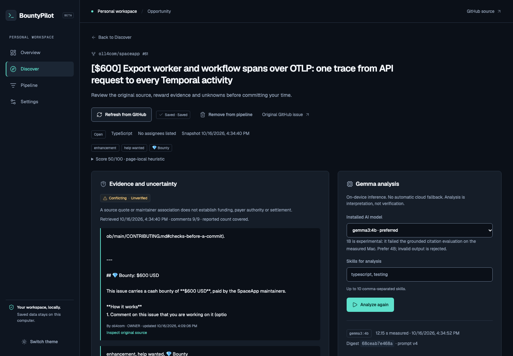
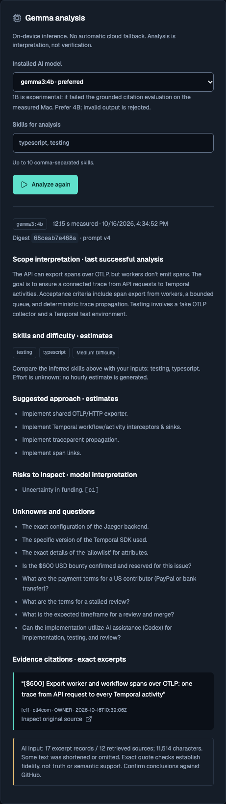
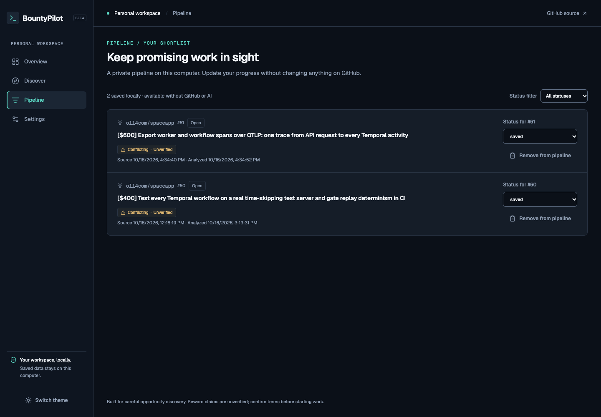
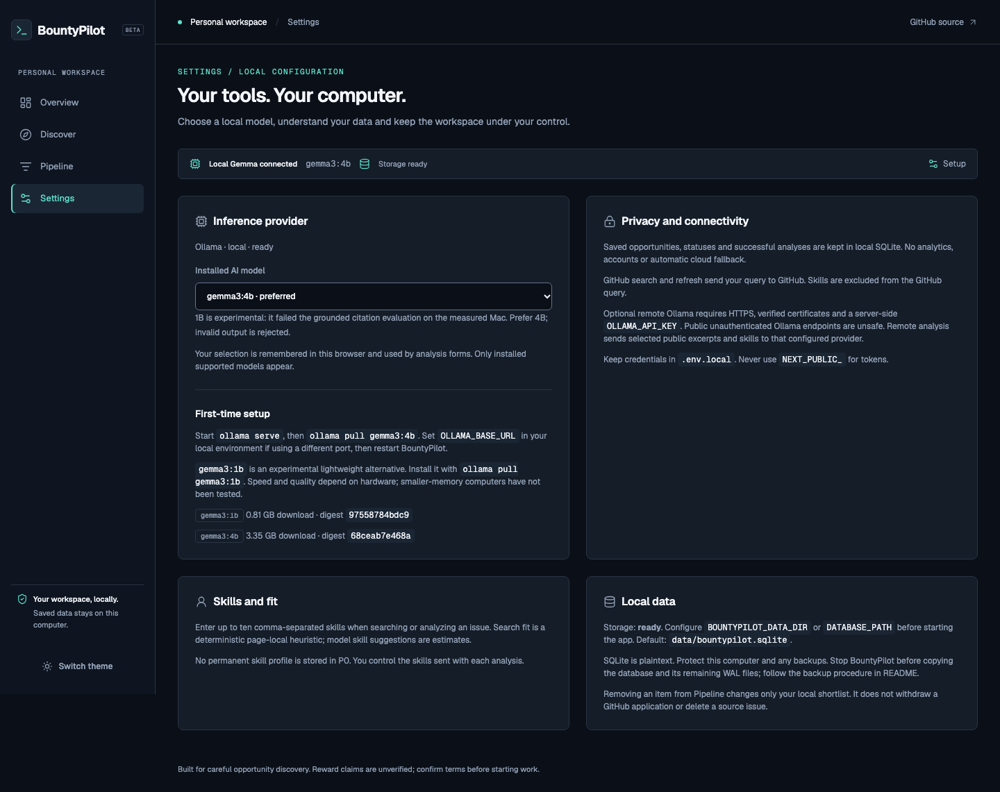
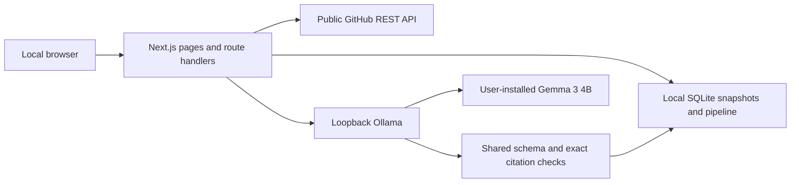

# BountyPilot

**Find coding opportunities. Evaluate them with local AI. Build your next side hustle.**

BountyPilot helps independent developers and freelancers search real public GitHub issues, inspect reward claims, evaluate technical scope with local Gemma, and keep a persistent private pipeline. A reward claim is **not verified funding or a payment guarantee**.

A single Next.js application, a local SQLite database, and Ollama. No mandatory AI subscription, paid inference API, account, or Python backend.

**AI decision for the Hacktoberfest submission:** Gemma 3 4B is the primary/default model; Ollama is the runtime that loads it and serves local inference. Ollama is not the model, and Gemma is distinct from the Gemini API. The existing `InferenceProvider` interface stays in place; Gemini, OpenAI and other cloud-provider integrations are deferred until after submission. No paid-provider fallback is implemented. Gemma 3 1B remains experimental after failing all 12 grounding checks.

## Screenshots

Actual application captures from October 16, 2026, using public GitHub issues and installed local Gemma. Issue titles contain authors' unverified reward claims; they are not BountyPilot earnings or endorsements. Views are bounded to omit personal contact details. See [capture provenance](docs/images/README.md).



<details>
<summary>Discover, inspect, analyze, save and configure</summary>







</details>

## Features

| Status | Capabilities |
| --- | --- |
| Available | Public GitHub issue search; repository/language filters; page-local skill scoring; evidence filtering/sorting; original source links and bounded discussion coverage |
| Available | Local Gemma 3 4B analysis; structured scope, skills, suggestions, risks and unknowns; exact source-quote validation; cancellation; last-good result preservation |
| Available | SQLite persistence; saved/evaluating/pursuing/archived statuses; pipeline filtering; overview; dark/light UI; installed supported-model selection |
| Experimental | Gemma 3 1B: all 12 measured grounding checks failed; invalid results were rejected. Not a proven lower-memory replacement |
| CI-verified | Installation, lint, types, 79 deterministic tests and production build on Linux/macOS/Windows with Node 24.14.0 and 24.21.0; seven Chromium checks per OS on 24.21.0 |
| Configurable, not live-verified | Authenticated HTTPS remote Ollama; interactive local Gemma workflows on Windows/Linux |
| Planned | Notifications, optional Gemini/OpenAI APIs, additional opportunity sources, improved low-resource inference, notes and Kanban |

## Why BountyPilot Is FOSS

Original application code is licensed **AGPL-3.0-only**: you may use, study, modify, self-host and redistribute it, including commercially, subject to the license's notices and source obligations. Modified network-service versions must offer their Corresponding Source to remote users. Read [LICENSE](LICENSE) and [third-party notices](THIRD_PARTY_NOTICES.md).

The project is open so developers can inspect how opportunities are ranked, challenge payment-evidence heuristics, reproduce analysis and improve it. Standard HTTP boundaries and a small inference interface reduce dependence on a single hosted vendor. Current supported local models are Gemma 3 4B and experimental 1B; arbitrary model/API-provider support is not implemented.

Local inference lets selected excerpts and skills remain on your computer when Ollama is local. SQLite is local plaintext, not encrypted or protected from other applications running as you. Search/detail refresh needs internet and GitHub's REST API. After installation and model download, retained evidence, the pipeline and analysis of a retained snapshot work offline with local Ollama; fresh discovery, refresh, installation and downloads require connectivity. Offline behavior has configuration-dependent limits; see verification evidence.

**Gemma is a separately licensed open-weight model, not AGPL/MIT application code or an OSI-approved model license.** Users obtain weights through Ollama and accept [Gemma terms](https://ai.google.dev/gemma/terms). We do not redistribute weights. Optional remote Ollama sends excerpts and skills to the configured operator. There is no automatic cloud fallback. Public GitHub content keeps its original authors' rights.

The three components have separate terms: BountyPilot's original code is AGPL-3.0-only, the external Ollama runtime is [MIT licensed](https://github.com/ollama/ollama/blob/main/LICENSE), and Gemma weights use Google's model terms. Neither Ollama binaries nor model weights are included in this source repository.

## Technology stack and architecture

Next.js App Router, React, TypeScript, Tailwind CSS, selected shadcn/ui-style controls backed by Radix, Lucide icons, Geist fonts, Zod, Node's built-in SQLite, GitHub REST, and Ollama/Gemma. Vitest, Playwright and GitHub Actions verify the application. Exact versions are pinned in [package.json](package.json) and [package-lock.json](package-lock.json).



One trusted local OS user, one Node process and one active inference. [Technical design](docs/ARCHITECTURE.md), [test strategy](docs/TEST_STRATEGY.md), [release verification](docs/RELEASE_VERIFICATION.md).

## Prerequisites

- **Node 24.22.0 recommended**, npm and Git. Declared runtime range: `>=24.14.0 <25`. Node 24.14/24.22 were previously tested on macOS; Node 22.9 is incompatible with installed test tooling. Do not disable engine checks.
- [Ollama](https://ollama.com/download) and `gemma3:4b` for AI. Discovery, evidence and saving work without Ollama. A current runtime may be needed to download the model.
- Internet for npm/model installation and fresh GitHub requests. An optional restricted public-read GitHub token increases authenticated quota; no token is required.
- Measured hardware: Apple M4 Pro, 12 CPU cores, 48 GiB RAM, macOS arm64. **This is not a minimum RAM requirement.** No lower-memory machine has been benchmarked. Installed 4B weights occupy approximately 3.35 GB; download size is not inference memory usage. Allow additional space for Node modules, builds and model working memory.

## Installation

Source is publicly available on GitHub. No packaged release or hosted deployment is provided.

### macOS

Install an official Node 24 runtime (or use your existing version manager) and Ollama, then:

```sh
git clone https://github.com/RishavRajSingh44/BountyPilot.git
cd BountyPilot
# With nvm installed: nvm install && nvm use
node --version
npm ci
cp .env.example .env.local
```

Start Ollama locally through its installed application or `ollama serve` in another terminal. Do not start a second server on an occupied port. Then:

```sh
ollama pull gemma3:4b
npm run dev
```

Open **http://127.0.0.1:3000**. Use that exact origin; `localhost` is deliberately rejected. Production local use: `npm run build`, then `npm start`. Keep BountyPilot bound to loopback; it has no authentication and is not ready for public hosting.

### Linux and Windows — CI checked; local Gemma workflow unverified

Linux uses the same repository/npm commands with an official Node 24 runtime and the Linux Ollama installer. In native PowerShell:

```powershell
git clone https://github.com/RishavRajSingh44/BountyPilot.git
Set-Location BountyPilot
node --version
npm ci
Copy-Item .env.example .env.local
# Start the installed Ollama application or ollama serve separately.
ollama pull gemma3:4b
npm run dev
```

Use a native OS-specific npm install; do not copy node_modules between platforms. [Compatibility documentation](docs/COMPATIBILITY.md) covers isolated Ollama ports, environment syntax, paths and remote configuration. [Publication CI](https://github.com/RishavRajSingh44/BountyPilot/actions/runs/38957344507) passed on Linux/macOS/Windows. It uses synthetic HTTP fixtures and does not validate Ollama installation or model performance on those runners.

## Configuration

Copy [.env.example](.env.example) into ignored `.env.local`. Changes require an app restart. Never put credentials in `NEXT_PUBLIC_*`, source, browser storage, screenshots or issues.

| Variable | Default / purpose |
| --- | --- |
| `GITHUB_TOKEN` | Empty; optional server-only public-read token |
| `OLLAMA_BASE_URL` | `http://127.0.0.1:11434`; Ollama origin only |
| `GEMMA_MODEL` | `gemma3:4b`; select an actually installed supported model |
| `OLLAMA_API_KEY` | Empty; required for an explicitly configured non-loopback HTTPS gateway |
| `APP_ORIGIN` | `http://127.0.0.1:3000`; exact accepted loopback origin |
| `BOUNTYPILOT_DATA_DIR` | `data`; database default directory |
| `DATABASE_PATH` | Optional local SQLite file override |
| `BOUNTYPILOT_CACHE_DIR` | `.cache`; test, browser and measurement artifacts |
| `BOUNTYPILOT_LOG_DIR` | `data/logs`; operator/script log location; app uses stdout |
| `BOUNTYPILOT_BUILD_DIR` | `.next`; build output |

npm's cache defaults to `.cache/npm`. `OLLAMA_HOST`, `OLLAMA_MODELS` and `OLLAMA_NO_CLOUD` configure the separate Ollama process, not the Next.js environment. See [isolated local setup](docs/COMPATIBILITY.md#local-ai). Custom private paths inside the repository must also be ignored. Gemini/OpenAI keys are not used by the current app.

## Usage

1. Start BountyPilot and local Ollama; Settings reports connection and installed supported models.
2. Search public GitHub issues in Discover. Language/repository filters affect the GitHub query; skills affect local page scoring.
3. Open a result and explicitly load its current GitHub sources.
4. Review original links, reward claims, conflicts and omitted/truncated discussion.
5. Choose installed Gemma 3 4B, optionally enter skills, and Analyze. The UI remains usable during inference; cancellation preserves the previous successful result.
6. Inspect quoted citations, suggestions and unknowns. Exact quotes establish source membership, not truth, entailment or funding.
7. Save the opportunity and update its local status.
8. Reopen Pipeline after a reload or restart. Status updates do not change GitHub or contact anyone.

## Testing

Run from the repository root using the supported Node runtime:

```sh
npm run lint
npm run typecheck
npm test
npm run build
npm run setup:browser
npm run test:e2e
npm audit --audit-level=high
```

`npm test` includes unit and service/integration tests with real SQLite and synthetic outbound HTTP boundaries. Browser tests launch their own production app and disposable database. They do not prove live GitHub or model behavior. Chromium downloads require internet. Exact current results and skipped checks: [RELEASE_VERIFICATION.md](docs/RELEASE_VERIFICATION.md).

Actual local-model probe: `npm run probe:model`. It unloads the selected model first and measures a short synthetic task; do not run during another person's inference. For the 12-case live corpus:

```sh
BOUNTYPILOT_LIVE_EVAL=1 npm test -- tests/live-model.test.ts
```

PowerShell: set `$env:BOUNTYPILOT_LIVE_EVAL='1'` first, run the test, then remove it with `Remove-Item Env:BOUNTYPILOT_LIVE_EVAL`. Live evaluation uses its own cache/database; outputs need manual semantic review. It is not a claim of paid opportunities or model reliability.

## Privacy, security and recovery

GitHub receives search queries and refresh requests; the application excludes the skills field from GitHub queries. Local Ollama receives selected source excerpts and skills. No telemetry SDK, user accounts, payments, tool execution or automatic paid-provider fallback is implemented. Next.js telemetry can be disabled with `NEXT_TELEMETRY_DISABLED=1`.

Optional remote Ollama requires verified HTTPS and a server-side bearer key behind an access-controlled gateway. **Never expose an unauthenticated native Ollama endpoint publicly.** Remote availability, retention and costs depend on its operator and have not been live-verified here. The local app remains unauthenticated and must not be exposed publicly.

SQLite defaults to `data/bountypilot.sqlite`. Backups are file copies, not an implemented export UI:

1. Stop BountyPilot and wait for exit. Keep original files.
2. Copy the database and any surviving `-wal` file together, preserving filenames, into a private backup directory. Do not copy a live main file alone.
3. Restore to a separate directory, never over the original. Set `DATABASE_PATH` to that restored file.
4. On the stopped restored copy, check with Node:

```sh
node --input-type=module -e "import {DatabaseSync} from 'node:sqlite'; const db=new DatabaseSync(process.argv[1]); console.log(db.prepare('PRAGMA integrity_check').all()); console.log(db.prepare('PRAGMA foreign_key_check').all()); db.close();" data/backup/bountypilot.sqlite
```

Expect `ok` and no foreign-key rows, then inspect Pipeline. Diagnose errors; never reset a personal database. [Security policy](SECURITY.md).

## Known limitations

- Reward amounts are source claims. No payer, funding, eligibility, settlement, earnings or income verification exists.
- Gemma 4B's small prompt-v4 evaluation produced 12/12 valid outputs, 11/12 manually useful; skills sometimes echo inputs and relevant context may be omitted. Historical results are not current guarantees.
- Gemma 1B failed all 12 grounded checks; one rejected response followed malicious source instructions. It remains experimental.
- Historical recorded live analysis: 12.147 seconds on the named M4 Pro/48 GiB Mac. Not a hardware minimum, universal latency or repeated benchmark.
- Interactive Windows/Linux Gemma workflows, lower-memory hardware, live secured remote Ollama and formal accessibility conformance are unverified. Automated installation/build/test checks passed on GitHub's three OS runners.
- GitHub quotas, 1,000-search-result limit and bounded discussion/prompt coverage can omit relevant evidence. Scores apply to one fetched page.
- Single user/process; no public SaaS authentication, billing, earnings tracking, notes, Kanban or notifications. Local SQLite is plaintext.

## Roadmap

Before submission, focus on the local Gemma demo, source/CI verification and reviewed DEV write-up. **After submission**, evaluate optional Gemini, OpenAI and other AI-provider APIs with explicit consent; keep Gemma/Ollama as the default and preserve the existing provider boundary. Other roadmap candidates are verified paid-opportunity integrations, opt-in notifications, improved low-resource inference, native platform validation and user-feedback improvements. These are proposals, not implemented features or deadline promises. Keep local Gemma central to the [Hacktoberfest demonstration](docs/HACKTOBERFEST_STRATEGY.md).

## Community

[Contributing](CONTRIBUTING.md) · [Issues](https://github.com/RishavRajSingh44/BountyPilot/issues) · [Security](SECURITY.md) · [Code of Conduct](CODE_OF_CONDUCT.md). Suggested first contributions and actual 2026 challenge guidance are in CONTRIBUTING.md. No customer, sponsor or revenue is claimed.

## License

Copyright © 2026 Rishav Raj Singh. Original application code: **[GNU AGPL v3 only](LICENSE)** (`AGPL-3.0-only`), without warranty. Third-party source, fonts, icons, data and models retain their own terms; see [THIRD_PARTY_NOTICES.md](THIRD_PARTY_NOTICES.md). Earlier MIT snapshots, if obtained under that license, retain their granted rights. A new license cannot withdraw them. There is no automatic royalty or payment from forks.

Release-check note: two analysis requests for an updated real discussion were rejected by the unchanged validation rules. A different real issue completed in 11.394 seconds and survived reload, process restart and a separate restored-copy check. Model validity is input-dependent; a successful historical demo does not guarantee a new discussion will analyze successfully. See RELEASE_VERIFICATION.md for the failures as well as the passes.
